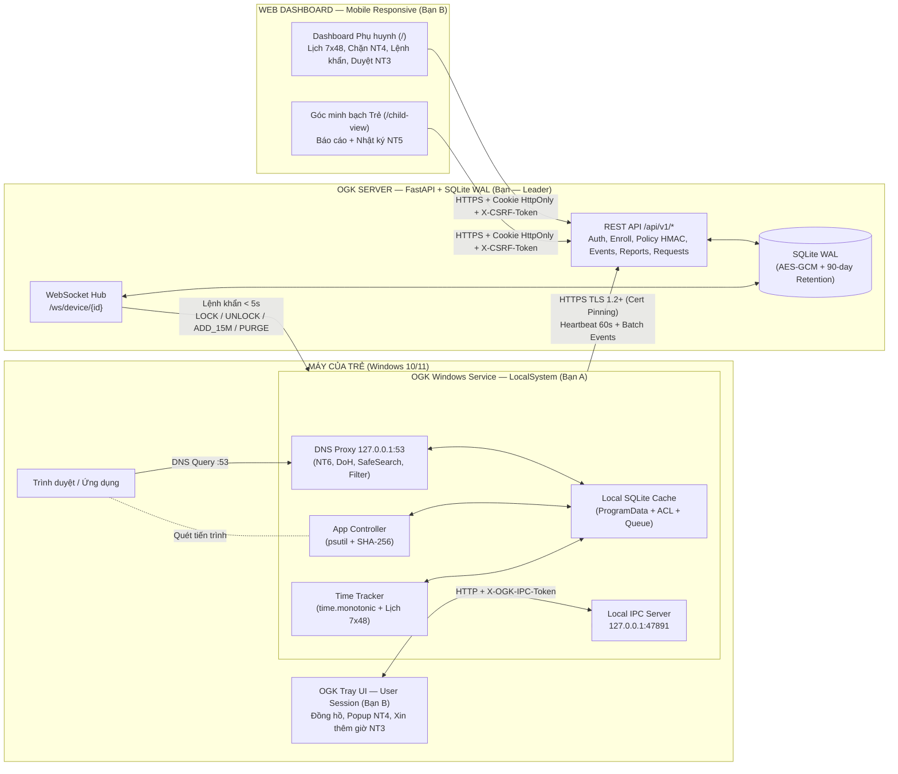
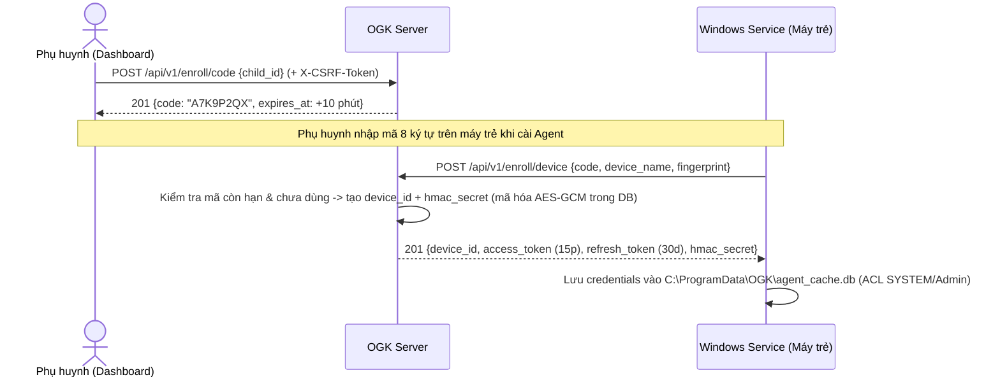
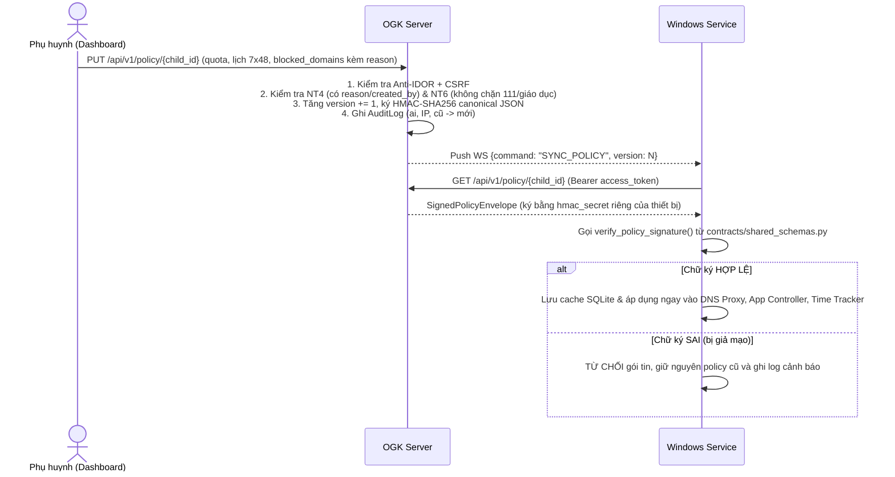

# TÀI LIỆU MÔ TẢ CHI TIẾT ĐỒ ÁN & CÁC LUỒNG HỆ THỐNG OGK
*(Tài liệu chung giúp cả 3 thành viên hiểu cùng một bức tranh trước khi code và trước khi vấn đáp)*

---

## 1. Đồ án OGK là gì? (Mục tiêu & Triết lý sống còn)

**OGK** (*Ông Giáo Khuyên / Companion Parental Control*) là hệ thống client–server giúp cha mẹ **đồng hành** cùng con (trọng tâm lứa tuổi 6–11) quản lý thời gian sử dụng máy tính Windows và lọc nội dung web/ứng dụng theo độ tuổi.

Điểm cốt lõi phân biệt OGK với phần mềm theo dõi lén (**spyware / stalkerware**) là **6 nguyên tắc minh bạch bắt buộc (NT1–NT6)**:

| Nguyên tắc | Ý nghĩa dễ hiểu | Thể hiện trực tiếp trong code |
|---|---|---|
| **NT1 — Nhận biết** | Trẻ luôn biết máy đang có OGK chạy | Icon khay hệ thống (Tray UI) luôn hiện; nếu Tray UI mất heartbeat > 30s, Service ngừng chạy ngầm và ghi cảnh báo `NT1_TRAY_NOT_VISIBLE_ALERT`. |
| **NT2 — Tối thiểu dữ liệu** | Chỉ ghi siêu dữ liệu vừa đủ, tuyệt đối không soi nội dung | `events.subject` **chỉ** lưu tên file `.exe` (`chrome.exe`) hoặc tên miền (`youtube.com`). Server trả `422` nếu gửi full URL, path hay tiêu đề cửa sổ. Không keylogger, không screenshot. |
| **NT3 — Trẻ có tiếng nói** | Trẻ được phản hồi, không bị khóa một chiều | Trẻ bấm **"Xin thêm giờ"** (`unlock_request`) hoặc **"Báo trang bị chặn nhầm"** (`false_positive_report`) ngay trên popup hoặc `/child-view`. |
| **NT4 — Giải thích được** | Chặn cái gì cũng phải nói rõ lý do và ai đặt | Mọi luật chặn bắt buộc có `reason` và `created_by`. Khi chặn, Tray UI bật popup giải thích thay vì giả vờ mất mạng. |
| **NT5 — Minh bạch hai chiều** | Cha mẹ xem gì, con cũng xem được cái đó | Tài khoản `child-view` gọi được `/summary` và `/audit-logs` (nhật ký cha mẹ đổi luật) ở chế độ chỉ đọc. |
| **NT6 — An toàn ưu tiên** | Không bao giờ chặn đường dây cứu hộ & học tập cốt lõi | Khóa cứng danh sách miễn chặn `111`, `tongdai111.vn`, `111.gov.vn`, `moet.gov.vn`, `olm.vn`… ở cả Server và DNS Proxy. |

---

## 2. Kiến trúc tổng thể (3 khối chính tương ứng 3 thành viên)



---

## 3. Chi tiết 7 Luồng hoạt động cốt lõi (Cả nhóm cần nắm vững)

### Luồng 1: Ghép đôi thiết bị lần đầu (Enrollment — Nghị định 13/2023)
Đây là điểm ghi nhận **sự đồng ý rõ ràng của cha mẹ** trước khi hệ thống thu thập dữ liệu.



### Luồng 2: Phụ huynh sửa luật & Đồng bộ Chính sách (HMAC-SHA256 + NT4/NT5/NT6)


### Luồng 3: Nhịp tim 60 giây & Chống trẻ chỉnh lùi đồng hồ (Heartbeat + M6)
1. Trên máy trẻ, `TimeTracker` **tuyệt đối không** dùng `datetime.now()` để tính thời lượng đã chơi mà dùng **`time.monotonic()`** (đồng hồ đơn điệu của nhân OS — chỉ tăng, không nhảy ngược khi đổi giờ Windows). Đồng thời tạm dừng đếm khi máy khóa màn hình hoặc không có thao tác phím/chuột quá 5 phút (`GetLastInputInfo`).
2. Mỗi **60 giây**, Agent gửi `POST /api/v1/heartbeat` kèm `device_ts` (giờ UTC hiện tại của máy trẻ), `policy_version`, `quota_used_seconds`, `tray_visible`.
3. Server tính `skew = abs(server_ts - device_ts)`:
   - Nếu `skew > 120 giây` (ví dụ trẻ lùi đồng hồ 3 giờ): Server tự động ghi `CLOCK_SKEW_DETECTED` vào `audit_logs` và trả về `clock_skew_detected: true` + `server_ts` chuẩn để Agent hiệu chỉnh mốc đối chiếu lịch `7×48`.
4. Nếu `policy_version` của Agent thấp hơn Server, Server trả `policy_update_required: true` kèm danh sách `pending_commands` chưa nhận được qua WebSocket.

### Luồng 4: Lọc Website qua DNS Proxy cục bộ `127.0.0.1:53` (Trọng tâm M1 & F2)
Khi trẻ gõ một địa chỉ web trên trình duyệt, đường đi gói tin như sau:

```text
Trình duyệt ──▶ Windows Stub Resolver ──▶ DNS Proxy của OGK (127.0.0.1:53)
                                                │
      ┌─────────────────────────────────────────┴────────────────────────────────────┐
      ▼                                                                              ▼
[Bước 1] Kiểm tra NT6 Whitelist (111, olm.vn, moet.gov.vn...)               ──▶ LUÔN CHO QUA (Forward Upstream)
[Bước 2] Kiểm tra DoH Canary (use-application-dns.net, mask.icloud.com...)  ──▶ TRẢ NXDOMAIN (tắt DoH tự động của browser)
[Bước 3] Kiểm tra DoH Endpoint (dns.google, cloudflare-dns.com...)          ──▶ CHẶN NXDOMAIN nếu bật block_doh_endpoints
[Bước 4] Kiểm tra SafeSearch (google.com, bing.com, duckduckgo.com...)      ──▶ ÁNH XẠ CNAME/A sang forcesafesearch
[Bước 5] Kiểm tra Allowlist / Blocklist & 6 nhóm danh mục (gồm subdomain)   ──▶ NẾU BỊ CHẶN:
           • Trả về NXDOMAIN / 0.0.0.0
           • Đẩy LocalIPCBlockNotice (kèm reason + created_by) sang Tray UI bật popup NT4
           • Ghi 1 sự kiện NT2 `blocked_domain` (chỉ lưu tên miền gốc, VD: `tiktok.com`)
[Bước 6] Miền hợp lệ còn lại                                                ──▶ Forward sang Upstream DNS (8.8.8.8/1.1.1.1)
```

### Luồng 5: Kiểm soát Ứng dụng theo Tên & Mã băm SHA-256 (F2 & NT4)
1. Mỗi 2 giây, `AppController` duyệt danh sách tiến trình bằng `psutil`.
2. Bỏ qua các tiến trình hệ thống/minh bạch bắt buộc trong `NT6_IMMUTABLE_WHITELIST_APPS` (`explorer.exe`, `ogk-tray.exe`, `ogk-service.exe`).
3. Tính **SHA-256** của tệp `.exe` (có cache theo đường dẫn + thời gian sửa file để tiết kiệm CPU). Dù trẻ có đổi tên `game.exe` thành `notepad.exe`, mã băm SHA-256 vẫn trùng luật chặn!
4. Nếu trùng luật chặn: kết thúc tiến trình (`terminate`/`kill`), gửi `LocalIPCBlockNotice` sang Tray UI để hiện popup giải thích lý do (NT4), và ghi sự kiện NT2 `blocked_app` (chỉ lưu tên `.exe`, không lưu full path).

### Luồng 6: Lệnh khẩn `< 5 giây` & Trẻ gửi yêu cầu (NT3 + WebSocket + Local IPC)
- **Chiều Trẻ → Phụ huynh (NT3):**
  1. Khi hết giờ hoặc bị chặn nhầm, trẻ bấm **"Xin thêm giờ"** hoặc **"Em nghĩ trang này bị chặn nhầm"** trên Popup của Tray UI.
  2. Tray UI gọi `POST http://127.0.0.1:47891/ipc/request` (kèm `X-OGK-IPC-Token` đọc từ `C:\ProgramData\OGK\ipc_token.txt`).
  3. Service chuyển tiếp lên `POST /api/v1/requests` trên Server (hoặc đệm offline nếu mất mạng).
  4. Phụ huynh mở Dashboard trên điện thoại/máy tính, thấy thông báo yêu cầu và bấm **Duyệt** kèm lời nhắn.
- **Chiều Phụ huynh → Máy trẻ (`< 5s`):**
  1. Khi phụ huynh duyệt `unlock_request` (hoặc bấm nút **Khóa ngay / Mở khóa / +15 phút / Tạm nghỉ 2h**), Server lưu vào `pending_commands` và lập tức đẩy JSON qua **WebSocket `/ws/device/{device_id}`**.
  2. Service nhận lệnh trong `< 1–2 giây`, thực thi ngay trên `TimeTracker`, gửi `ACK` ngược lại Server và báo Tray UI cập nhật đồng hồ cho trẻ thấy.

### Luồng 7: Chế độ Ngoại tuyến (Offline), Chống trùng & Quyền xóa dữ liệu (M5 & F3)
- **Khi mất mạng hoặc Server tạm ngừng:**
  - Agent tiếp tục đọc Policy từ SQLite cục bộ (chỉ dùng nếu pass `verify_policy_signature()`), tiếp tục lọc DNS/App và đếm giờ bằng `time.monotonic()`.
  - Mọi sự kiện phát sinh được ghi vào hàng đợi `event_queue` kèm một **`idempotency_key`** duy nhất (UUID/hash).
  - Khi mạng có lại, Agent gửi từng lô lên `POST /api/v1/events/batch`. Server lọc trùng bằng `idempotency_key` nên dù mạng chập chờn gửi lặp 2–3 lần, thời gian sử dụng **không bao giờ bị cộng đúp**.
  - **Chính sách hết hạn sau `N = 7 ngày` mất kết nối (`offline_expiry_mode`):** Hệ thống chọn **`fail_open_with_education_only`** (mở nhóm giáo dục & NT6 để không cản trở việc học nếu máy đi xa mất mạng dài ngày, đồng thời giữ chặn nhóm `age_inappropriate` và `social_media` từ cache cũ). Cả nhóm cần thống nhất lập luận này khi vấn đáp!
- **Tự động xóa sau 90 ngày & Nút Purge:**
  - Server chạy background task `retention.py` tự động xóa `events` và `audit_logs` cũ hơn 90 ngày.
  - Khi phụ huynh bấm **"Xóa toàn bộ dữ liệu của con tôi"** (`DELETE /api/v1/reports/{child_id}/purge`), Server xóa lập tức toàn bộ lịch sử sự kiện của trẻ trên DB và phát lệnh `PURGE_CACHE` qua WebSocket/Heartbeat để Agent xóa sạch bộ đệm cục bộ.

---

## 4. Điểm khớp nối (Contracts) giữa 3 thành viên

Để 3 người code song song **không bao giờ bị lệch đầu nối**, mọi giao tiếp đều cố định tại 2 ranh giới:

| Ranh giới giao tiếp | Bên cung cấp | Bên gọi | Hợp đồng cố định |
|---|---|---|---|
| **Server ↔ Agent Service** | Bạn (Leader) | Bạn A | `contracts/api_contract.md` (Mục 2–6, 8) + `contracts/shared_schemas.py` |
| **Server ↔ Web Dashboard** | Bạn (Leader) | Bạn B | `contracts/api_contract.md` (Mục 1–3, 5, 7, 8) + Swagger `/docs` |
| **Agent Service ↔ Tray UI** | Bạn A | Bạn B | `contracts/api_contract.md` (Mục 9 — Local HTTP `127.0.0.1:47891` + `X-OGK-IPC-Token`) |

---

## 5. 6 Câu hỏi giảng viên RẤT HAY hỏi lúc vấn đáp (Cả 3 người cần thuộc)

1. **Tại sao chọn DNS Proxy cục bộ thay vì sửa file `hosts` hay làm HTTP/HTTPS Proxy giải mã TLS?**
   - *Trả lời thống nhất:* File `hosts` không chặn được wildcard subdomain (`*.tiktok.com`), không ép SafeSearch động và không đếm được lượt truy vấn. HTTPS MITM Proxy phải cài Root CA giả vào máy trẻ, dễ vi phạm quyền riêng tư (đọc được URL chi tiết — trái NT2) và làm lỗi nhiều ứng dụng có Certificate Pinning. **DNS Proxy `127.0.0.1:53`** cân bằng tối ưu giữa hiệu năng, chặn subdomain, cưỡng chế SafeSearch và tuân thủ tuyệt đối NT2.
2. **Nếu trẻ bật DNS-over-HTTPS (DoH) hoặc cài VPN thì sao?**
   - *Trả lời thống nhất:* Với DoH, OGK chặn các điểm cuối DoH phổ biến (`dns.google`, `cloudflare-dns.com`…) và trả `NXDOMAIN` cho tên miền canary (`use-application-dns.net`) để Firefox/Chrome tự rơi về DNS hệ thống, kết hợp khuyến nghị cấu hình Group Policy trình duyệt. Với VPN cổng 443 hoặc boot USB, đây là **giới hạn vốn có của tầng DNS** — nhóm thừa nhận rõ trong mục M3 và xử lý bổ sung ở tầng tiến trình (`AppController` chặn app VPN) + phân quyền tài khoản Windows chuẩn (không cho trẻ quyền Administrator).
3. **Làm sao chống trẻ sửa file DB hoặc tắt dịch vụ?**
   - *Trả lời thống nhất:* Tài khoản Windows của trẻ là Standard User (không thuộc Administrators); thư mục `C:\ProgramData\OGK` đặt ACL chỉ `SYSTEM` và `Administrators` được ghi; Service chạy dưới `LocalSystem` có SCM Recovery tự khởi động lại; Policy được ký `HMAC-SHA256` nên sửa file cache sẽ bị phát hiện và từ chối. (Tuyệt đối không dùng rootkit ẩn tiến trình vì vi phạm Danh mục cấm).
4. **Làm sao chứng minh sản phẩm không phải spyware/stalkerware?**
   - *Trả lời thống nhất:* Dẫn chứng 4 cơ chế trong code: (1) Tray UI bắt buộc hiện & gửi heartbeat mỗi 10s; (2) Validator NT2 trả `422` nếu gửi full URL/window title; (3) Tài khoản `child-view` xem được cả báo cáo lẫn `audit_logs` của phụ huynh; (4) Danh sách khẩn cấp `111` không thể bị xóa/chặn.
5. **Làm sao chống IDOR giữa 2 phụ huynh?**
   - *Trả lời thống nhất:* Kiểm tra ở tầng DB query trong `server/app/core/security.py` (`get_authorized_child`, `get_authorized_device`), không chỉ ẩn trên giao diện, và đã có unit test tự động `test_anti_idor_between_two_parents` kiểm chứng mã `403`.
6. **Nếu mất mạng 10 ngày thì chọn fail-open hay fail-closed?**
   - *Trả lời thống nhất:* Chọn **`fail_open_with_education_only`** (đã khai báo trong Policy): sau 7 ngày offline, luôn đảm bảo mở các nhóm giáo dục & NT6 để không gián đoạn việc học, nhưng vẫn giữ luật chặn nội dung không phù hợp từ bản cache đã kiểm chứng chữ ký HMAC.
